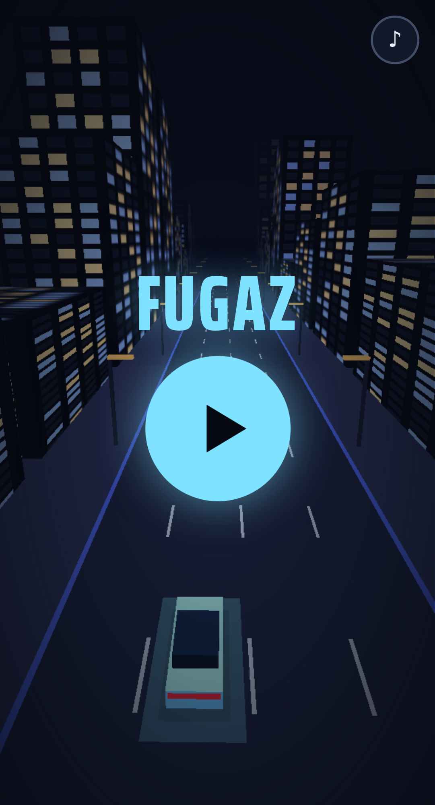
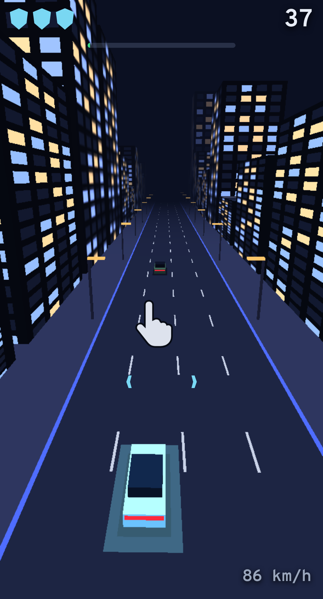
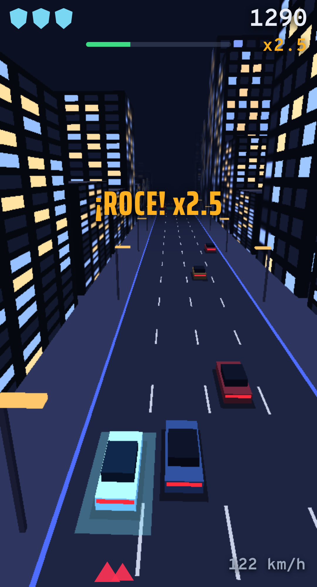
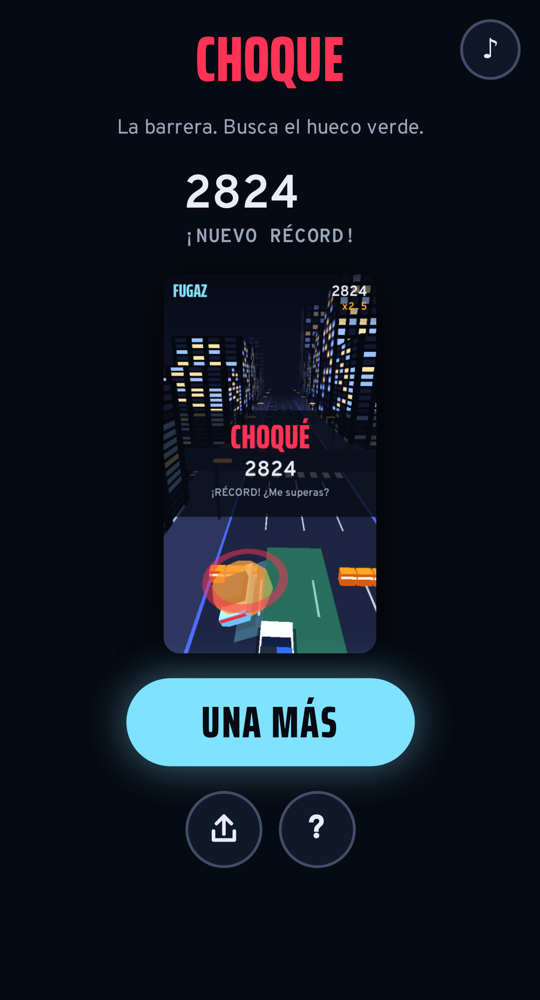
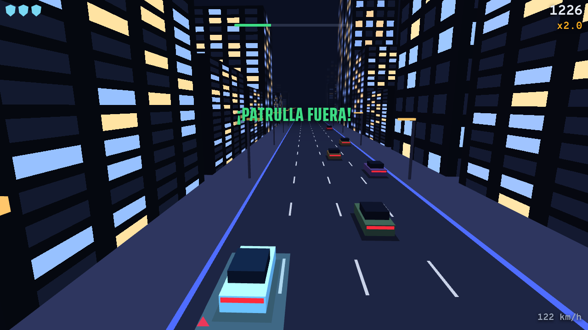
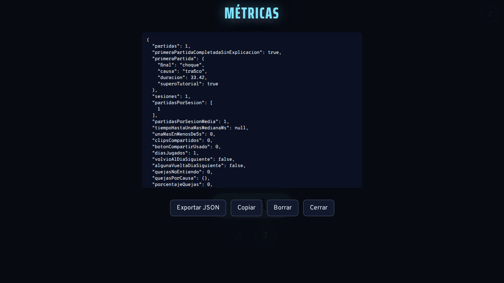

# Informe · prototipo «persecución y escape» · 22-oct-2026

Rama: `prototipo-escape` (sale de `sesion-1`, que ya tenía three.js y las fuentes en el repositorio y las pruebas de Playwright). No se ha publicado nada.

## Resumen

1. **Hecho:** `escape/` es un prototipo jugable de principio a fin en PC (teclado) y en móvil (un pulgar).
   - Partidas de 75 s; la primera dura 85 s porque lleva el tutorial.
   - Cuenta atrás, patrullas agresivas, tráfico, cruces, barreras y multiplicador por roces.
   - Muerte rápida y «una más» en menos de 2 s.
   - Clip vertical de la repetición y métricas exportables en JSON.
2. **Pila real:** three.js **r128**, con física y colisiones **escritas a mano**. **No hay Rapier** (el informe 140 lo suponía). El prototipo sigue igual: colisiones de cajas en 2D, sin motor de física.
3. **Pruebas:** 9 pruebas de Playwright en verde (2 de FUGAZ original y 7 del prototipo).
4. **No verificado:** 60 fps en un móvil medio real. En Chromium sin GPU da 39 fps en un Pixel 5 emulado, con un fotograma lento (p95) de 50 ms. La lógica cuesta 11 µs por paso.
5. **Falta** (detalle en `TODO.md`):
   - probarlo en móviles reales;
   - un enlace https de prueba, que decide el despacho;
   - ajustar la dificultad con personas.

## 1. Pila y por qué un prototipo aparte

- `index.html` (FUGAZ v12) es un archivo generado de 13 981 líneas con 33 módulos concatenados (`// ---- src/...`). Su física es muy detallada: muelles, vuelcos, taller, cabina…
- El concepto C pide otra cosa: partidas cortas, un solo control y lectura instantánea a alta velocidad. No he separado `index.html` en módulos, porque no hacía falta para trabajar.
- He escrito el prototipo como **módulos ES nuevos** en `escape/js/`, reutilizando la identidad de FUGAZ: paleta, fuentes, ciudad nocturna y el generador aleatorio con semilla.
- La lógica (`mundo.js`) no depende de three.js ni del DOM. Por eso se puede simular sin pantalla (`herramientas/simular.mjs`) y se ajustó la dificultad con cientos de partidas automáticas.

## 2. El bucle

- **Cuenta atrás** 3-2-1 de 1 s.
- **Velocidad:** el coche acelera solo de 108 a 173 km/h a lo largo de la partida. Solo se gira.
- **Obstáculos:**
  - tráfico en 4 carriles; los de la izquierda van más lentos y se abren huecos;
  - cruces con coches que atraviesan la avenida (semáforos ámbar);
  - barreras con un hueco marcado en verde en el suelo.
- **Patrullas:** de 1 a 4 según el tiempo. Su IA es simple pero agresiva:
  - te alcanzan siempre, porque corren más cuanto más lejos van;
  - se ponen a tu lado y, si vas pegado a la acera, por dentro para empotrarte;
  - avisan con un triángulo rojo 0,45 s antes de embestir;
  - esquivan el tráfico con un retraso al azar de 0,12 a 0,42 s, así que un roce tuyo bien hecho las estrella;
  - si las embistes tú primero, las apartas; si las estampas contra la acera, quedan fuera.
- **Muerte:** un choque o 3 embestidas. Se recupera un escudo cada 7 s sin golpes.
- **Multiplicador por riesgo:**
  - pasar a menos de 1 m de un coche o barrera sin tocarlo sube ×0,5;
  - hacer chocar a una patrulla sube ×1;
  - baja si pasas 3 s sin arriesgar.
  - La caja de choque del jugador es un 18 % más pequeña que el coche dibujado, para que rozar sea posible y justo.
- **Final:** a los 75 s aparece el túnel de salida y escapas (+25 %).
- **«Una más»:**
  - el golpe va a cámara lenta 0,6 s;
  - la pantalla final tiene el botón grande «UNA MÁS» activo desde el primer momento (también Espacio o Intro);
  - la prueba automática mide menos de 2 s desde el toque hasta volver a jugar.
- **Lo que te mata se explica sin pantallas:**
  - la repetición acaba a cámara lenta con un anillo rojo sobre el culpable;
  - una línea dice la causa (por ejemplo, «La barrera. Busca el hueco verde.»);
  - el botón «?» registra «no entiendo qué me mata» junto a la causa real.

## 3. Tutorial sin texto (primera partida, 10 s)

- Va más despacio (86 km/h) y sin policía.
- En pantalla aparece una mano que desliza (en el PC, las teclas ← → que se iluminan). Desaparece en cuanto has girado a los dos lados.
- Guion de obstáculos:
  - a los 0,3 s, un coche en tu carril (hay que girar);
  - a los 3,6 s, dos coches en tu carril y el de al lado (hay que girar más);
  - a los 6,4 s, una barrera con el hueco verde al otro lado.
- A los 10 s llegan las sirenas.
- Si mueres en el tutorial, la siguiente partida lo repite. Cuando lo pasas, ya no vuelve a salir.

## 4. Métricas (tarea 140)

- Se guardan en `localStorage` (`fugazEscape.metricas`). El panel oculto se abre con 5 toques en el logo, Mayús+M o `#metricas`, y exporta un JSON con un resumen y los datos en bruto.
- Métricas:
  - primera partida completada sin explicación;
  - partidas por sesión;
  - tiempo hasta «una más» (mediana);
  - clips compartidos (y veces que se pulsó el botón);
  - vuelta al día siguiente;
  - quejas «no entiendo qué me mata», por causa;
  - además, fps medios, roces, patrullas fuera y abandonos (cerrar o cambiar de app a mitad de partida).
- Las definiciones exactas están en el README.
- **Aviso:** la tarea 140 está fuera de la carpeta. Las normas del taller no dejan salir de ella, así que no la he leído. Las métricas salen de la lista del encargo; conviene cotejarlas.

## 5. Clip compartible

- Durante la partida se guardan las «vistas» de los últimos 8 s: unos pocos números por fotograma, sin imágenes.
- Al morir, la repetición se vuelve a dibujar en **vertical 405×720** en un lienzo 2D, con el marcador encima, cámara lenta al final y una tarjeta «CHOQUÉ / ESCAPÉ · puntos · ¿Me superas?».
- Se graba con `MediaRecorder` en mp4 si el navegador puede y, si no, en webm.
- Si no se puede grabar, queda una **imagen-resumen PNG 1080×1920** con:
  - el recorrido visto desde arriba;
  - los roces, las patrullas caídas y el punto final;
  - los puntos y el récord.
- El botón compartir usa el menú del sistema (`navigator.share` con el archivo) cuando está disponible y, si no, descarga el archivo.

## 6. Rendimiento

- **Escena ligera:**
  - edificios, rayas y farolas en `InstancedMesh`;
  - coches de cajas con materiales Lambert, sin sombras dinámicas ni luces puntuales;
  - niebla a 250 m.
- **Ajustes de calidad:**
  - en móvil, sin antialias y con densidad de píxeles 1,5 como máximo;
  - **calidad adaptable**: si en 2 s no llega a 50 fps, baja la densidad de píxeles por pasos hasta 0,75.
- **Mediciones** (`node herramientas/medir.mjs`):
  - lógica: 11,2 µs por paso;
  - Chromium **sin GPU** (swiftshader): 39 fps en un Pixel 5 emulado y 18 fps a 1280×720.
  - Son el peor caso: todo el 3D se dibuja con la CPU. **Un móvil real no se ha podido probar.** Cada partida guarda sus fps medios en las métricas, así que la primera prueba de Alberto en su móvil dará el dato real.

## 7. Pruebas

`npx playwright test` da 9 pruebas en verde (unos 40 s):

- **FUGAZ original:** arranca sin errores ni peticiones externas; un `localStorage` corrupto no lo rompe.
- **PC:** se juega con el teclado (la flecha mueve el coche) y la partida acaba en ESCAPASTE; la métrica «completada sin explicación» queda en `true`.
- **Muerte:** sin girar, algo te mata; el «?» registra la queja con su causa; «una más» vuelve a jugar en menos de 2 s; se cuentan las partidas por sesión y el tiempo hasta una más.
- **Clip:** se genera y el botón compartir lo entrega (descarga en el navegador headless).
- **Métricas:** el panel oculto exporta un JSON con todas las métricas; la vuelta al día siguiente se detecta.
- **Datos corruptos:** no rompen el arranque.
- **Móvil (Pixel 5 emulado):** se ve la mano del tutorial, deslizar el dedo gira el coche y la partida termina con «una más».

## 8. Capturas (`ENCARGOS/informes/capturas/`)

| | |
|---|---|
| Inicio (móvil) |  |
| Tutorial: la mano que desliza |  |
| Persecución con multiplicador |  |
| Pantalla final con el clip vertical |  |
| PC |  |
| Panel oculto de métricas |  |

Las capturas se hicieron con GPU por software. Los colores y la nitidez en un móvil real serán algo mejores.

## 9. Aceptación

| Criterio | Estado |
|---|---|
| Se juega de principio a fin en móvil y PC | Sí en PC (Chromium) y en un móvil emulado. **Falta un móvil real.** |
| Las métricas se exportan | Sí (JSON desde el panel oculto, con prueba automática). |
| Pruebas en verde | Sí, 9/9. |
| Nada publicado | Sí. Solo el push de la rama `prototipo-escape` a GitHub. |
| 60 fps en un móvil medio | **Sin verificar.** Hay calidad adaptable y medición de fps por partida. |

No incluye (como pide el encargo): multijugador, tienda, VR, emisora RC ni página de Steam.
